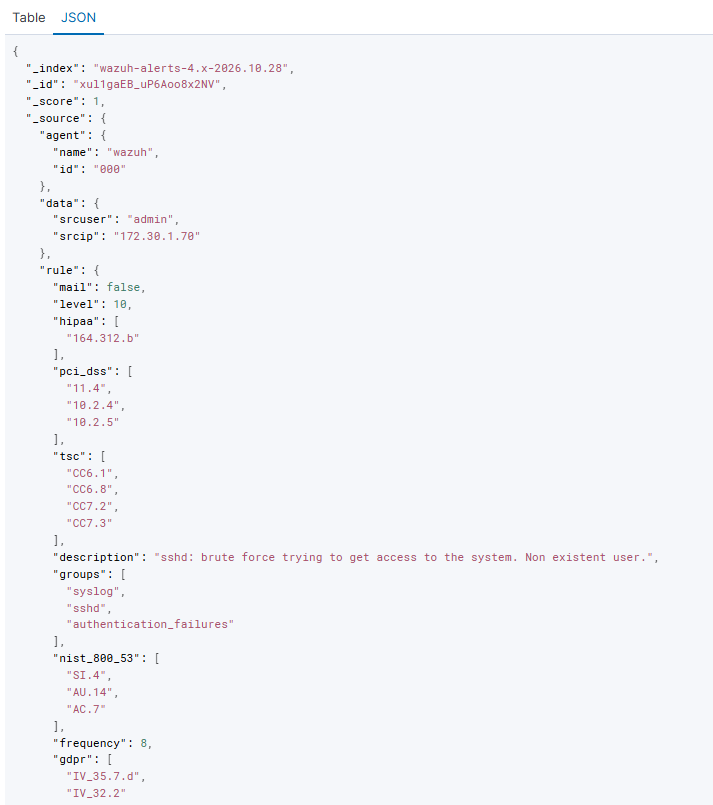

# wazuh-detection-lab

> A home SOC lab for hands-on detection engineering: building a Wazuh SIEM from
> scratch, simulating an SSH brute-force attack, and analyzing the resulting alerts.

<!-- TODO: 한 줄 더 — 왜 이걸 만들었는지 당신의 언어로. 예시:
"I work as a SOC analyst and built this lab to practice detection and tuning
outside of production." 아래 빈 줄에 영어로 직접 써보세요. -->

**About me:** [ 여기에 1~2문장. 현재 보안관제 경력 + 이 랩을 만든 이유 ]

---

## 1. Overview

This lab demonstrates a full detection cycle on a self-hosted SIEM:

1. An attacker host (Kali) runs an SSH brute-force attack against a monitored server.
2. The Wazuh manager parses the authentication logs in real time.
3. Correlation rules escalate repeated failures from a low-severity event to a
   high-severity brute-force alert.
4. Alerts are reviewed and mapped to compliance frameworks (PCI DSS, NIST 800-53).

**Skills shown:** SIEM deployment, log analysis, detection rule interpretation,
attack simulation, Linux administration, network troubleshooting.

---

## 2. Architecture

```
┌─────────────────┐         SSH brute force          ┌──────────────────────┐
│  Kali Linux     │  ──────────────────────────────▶ │  Ubuntu Server 24.04 │
│  (attacker)     │         (hydra, port 22)         │  Wazuh all-in-one    │
│  192.0.2.70     │                                  │  192.0.2.50          │
└─────────────────┘                                  │  - manager           │
                                                     │  - indexer           │
                                                     │  - dashboard         │
                                                     └──────────────────────┘
```

<!-- TODO: 캡처가 준비되면 이 자리에 네트워크 다이어그램 이미지로 교체해도 좋습니다.
지금은 위 ASCII 그림으로 충분합니다. -->

---

## 3. Lab Setup

| Component      | Detail                                   |
| -------------- | ---------------------------------------- |
| Hypervisor     | VMware Workstation Player                |
| SIEM host OS   | Ubuntu Server 24.04 LTS                  |
| SIEM           | Wazuh 4.14 (all-in-one: manager, indexer, dashboard) |
| Attacker       | Kali Linux                               |
| Network        | Bridged, same subnet                     |
| Host resources | 4 cores / 8 threads, 16 GB RAM, NVMe SSD |

Index retention is managed with an ISM policy that deletes `wazuh-alerts-*`
indices after 7 days to control disk usage.

---

## 4. Attack Scenario

From the Kali host, an SSH brute-force attack was launched against the Wazuh
server using `hydra`:

```bash
hydra -l admin -P /usr/share/wordlists/rockyou.txt ssh://192.0.2.50 -t 4 -f
```

- `-l admin` — target a non-existent username
- `-P rockyou.txt` — password list
- `-t 4` — 4 parallel attempts to trigger correlation quickly

<!-- TODO: 캡처 1 — Kali에서 hydra 실행 중인 터미널 -->


---

## 5. Detection Result

The attack generated two levels of alerts, showing how Wazuh escalates from a
single failure to a correlated brute-force event.

### Single failure — Rule 5710 (level 5)

```
Rule: 5710 (level 5) -> 'sshd: Attempt to login using a non-existent user'
Src IP: 192.0.2.70
Oct 28 07:35:51 wazuh sshd[25469]: Failed password for invalid user admin from 192.0.2.70
```

### Correlated failures — Rule 2502 (level 10)

```
Rule: 2502 (level 10) -> 'syslog: User missed the password more than one time'
Oct 28 07:39:59 wazuh sshd[31075]: PAM 5 more authentication failures; rhost=192.0.2.70
```

**Key point:** the same source IP triggered a single-event rule (level 5) and,
once failures accumulated, a correlation rule raised the severity to level 10.
This is the core of detection engineering — turning raw events into an
actionable "this is an attack" signal.

<!-- TODO: 캡처 2 — 대시보드 Threat Hunting, 경보 표 (2502/5710 보이게) -->


<!-- TODO: 캡처 3 — 경보 하나를 펼친 JSON 상세 (rule.id, data.srcip 등 필드) -->


---

## 6. Compliance Mapping

Each alert is automatically tagged with the compliance controls it relates to.
For the SSH authentication-failure alerts above, Wazuh mapped them to:

| Framework    | Control         | Meaning                                       |
| ------------ | --------------- | --------------------------------------------- |
| PCI DSS      | 10.2.4 / 10.2.5 | Log invalid access attempts and auth activity |
| NIST 800-53  | AC.7 / AU.6     | Unsuccessful logon attempts, audit review     |
| HIPAA        | 164.312.b       | Audit controls                                |
| GDPR         | IV_32.2         | Security of processing                        |

This matters because it links a technical detection to a business/regulatory
requirement — the way a security team justifies monitoring to auditors.

---

## 7. Troubleshooting Notes

Real issues encountered while building this lab and how they were resolved:

<!-- TODO: 아래는 당신이 실제로 겪은 것들입니다. 각 항목을 당신 언어로 다듬으세요.
영어가 어색해도 괜찮습니다 — 직접 쓴 흔적이 오히려 신뢰를 줍니다. -->

- **Wrong Ubuntu version:** The latest ISO installed Ubuntu 26.04, which is not
  in Wazuh 4.14's supported list, causing `wazuh-manager` to fail to start.
  Resolved by reinstalling Ubuntu Server 24.04 LTS.
- **Root partition too small:** The installer allocated only part of the disk to
  the root LVM volume. Extended it with `lvextend` + `resize2fs`.
- **Network connectivity:** Host-to-VM traffic failed under NAT (missing VMnet8
  adapter in VMware Player). Switched to bridged networking and aligned all VMs
  to the same subnet.
- **Manager API not ready:** The dashboard showed `wazuh-modulesd->stopped`.
  Resolved by restarting the `wazuh-manager` service.

---

## 8. Next Steps

- [ ] Add a separate victim server and install a Wazuh agent on it
- [ ] Extend the lab to AWS (EC2 victim over Tailscale) to collect real-world
      attack data
- [ ] Write a custom detection rule and tune out false positives
- [ ] Integrate Sysmon on a Windows endpoint

---

## License

MIT
